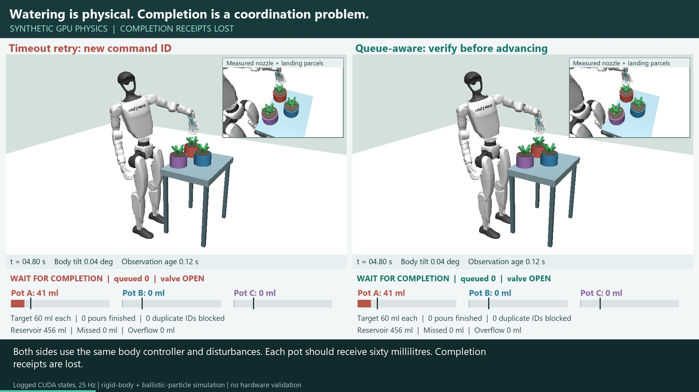

# Humanoid Gardening Queues

**GPU-physics experiments in queue-aware coordination: remembering a task is not
the same as having authority to execute it.**

## New: Engineering Memory and Physical Actions

[](https://github.com/rbajaj5/humanoid-gardening-queues/releases/download/engineering-memory-narrated-2026-10-27/engineering_memory_narrated.mp4)

**[Watch the narrated lesson (3:44, 1080p, English explanation, Mandarin pronunciations and captions)](https://github.com/rbajaj5/humanoid-gardening-queues/releases/download/engineering-memory-narrated-2026-10-27/engineering_memory_narrated.mp4)**

**Measured render + video encode: 4 min 44.57 s (284.57 s)** for 5,599 frames at
1920x1080 / 25 fps. This is one observed run, from FFmpeg's final elapsed-time
record. It excludes speech generation, initial model setup, audio assembly,
final audio/subtitle muxing, validation and the earlier physics simulations.
Laptop: Intel Core Ultra 9 275HX, 32 GB RAM, RTX 5070 Ti Laptop GPU with 12 GB VRAM.
CPU libx264 handles encoding; this replay used Intel Graphics for OpenGL rendering.
The original physics used NVIDIA CUDA. [Timing details](memory_study/lesson/output/render_timing.json).

The revised video explains the Chinese engineering vocabulary instead of only
displaying labels: working memory, session state, team memory, memory fragments,
observation freshness, and long-term memory. Definitions pause on the initial
state; then the measured robot replay runs; finally the narrator explains the
outcome. Our interpretations are distinguished from the vendors' descriptions.
The English and Mandarin voices are synthetic neural speech, not a human speaker.

[Term-by-term glossary, sources and narration method](memory_study/lesson/README.md)
| [Captions](memory_study/lesson/output/captions.srt)
| [Exact narration script](memory_study/lesson/script.json)
| [Render timing record](memory_study/lesson/output/render_timing.json)

This is a teaching revision, **not a new batch of simulation results**. The
[original 60-second silent comparison](https://github.com/rbajaj5/humanoid-gardening-queues/releases/download/engineering-memory-gpu-2026-10-26/engineering_memory_gpu.mp4)
remains available, separately from the earlier narrated watering demo below.

The same mass-bearing humanoid waters three plants while four execution policies
handle plan replay, shared task state, stale observations, and an observation
outage. **MuJoCo Warp CUDA integrates the robot; Warp CUDA integrates ballistic
water parcels.** The task controller, rendering and encoding are separate from
GPU physics. These are synthetic experiments, not hardware or vendor validation.

Chinese engineering documentation motivates the distinctions between session
state, long-term memory and shared team knowledge. We test our own operational
interpretations, not Alibaba or Tencent implementations or an LLM's memory.
In the shared-state case, two software planners coordinate **one physical robot**.

### New Measured Results

Five scenarios x four policies x two matched seeds = **40 episodes**, each 40 s.
The target is **60 ml per pot**. Entries below are measured water captured by
pots A / B / C, in ml; both seeds produced these dose outcomes.

| Scenario | Memory only | Stable IDs | IDs + freshness | Queue-aware budget |
|---|---:|---:|---:|---:|
| Nominal | 60 / 60 / 60 | 60 / 60 / 60 | 60 / 60 / 60 | 60 / 60 / 60 |
| Same plan replayed | 120 / 120 / 120 | 60 / 60 / 60 | 60 / 60 / 60 | 60 / 60 / 60 |
| Two planners, shared snapshot | 120 / 120 / 120 | 120 / 120 / 120 | 120 / 120 / 120 | 60 / 60 / 60 |
| Old snapshot recalled | 120 / 120 / 120 | 120 / 120 / 120 | 60 / 60 / 60 | 60 / 60 / 60 |
| Observations stop | 60 / 60 / 60 | 60 / 60 / 60 | 60 / 0 / 0 | 60 / 0 / 0 |

Stable IDs address replayed commands; timestamps address stale evidence; the
queue-aware policy additionally reserves a shared per-pot budget for queued,
active and completed pours in the same watering cycle. Distinct planners can
have different IDs for the same physical intention, so deduplication alone does
not address that case.

**The cost is visible:** during the outage, freshness-gated policies hold for
34.28 s and leave a 120 ml total shortfall. Excess above the 60 ml task target
is not necessarily pot overflow or plant damage. Two seeds and deliberately
constructed faults do not establish field reliability or general superiority.

**Evidence:** 27 tests passed; the independent trace audit covers all 40,000
retained states. The narrated replay illustrates seed 45110 only, with paused
definitions and accelerated traversal of each 40 s episode. Its
[frame manifest](memory_study/lesson/output/movie_frames.json) reports exact
unique-sample coverage, and its [media audit](memory_study/lesson/output/validation.json)
checks decoded video, audible narration and source-state links. It does not
depict aggregate outcomes as a single trajectory. The original silent reel's
1,500-frame audit and 251/1,000-sample coverage remain separately recorded.

- [Study, Chinese documentation and reproducible commands](memory_study/README.md)
- [Full measured results](memory_study/output/RESULTS.md) and [episode summaries](memory_study/output/summaries.json)
- [Trace audit](memory_study/output/validation.json), [video audit](memory_study/output/media_validation.json), and [frame-to-state mapping](memory_study/output/movie_frames.json)
- [Configuration](memory_study/config.json), [coordination policies](memory_study/protocol.py), and [CUDA experiment runner](memory_study/run.py)

The earlier physical and task-level studies remain intact below; their sample
counts are separate from this new suite.

### Related: Neural Hanzi with Drone Landing Close-Ups

The [new Neural Hanzi landing lesson](https://github.com/rbajaj5/delay-aware-runtime-assurance-lab/tree/main/experiments/20261027_gpu_fleet_scaleup/neural_hanzi)
extends Ravi Bajaj's queue-aware research illustration from one physical robot
to sixteen quadrotors. Large matched landing close-ups retain a full-fleet
overview below. The 3:10 video explains the same six terms: 工作记忆 (active task
state in this engineering example), 会话状态 (session state), 团队记忆 (team memory),
记忆片段 (memory fragments), 观测时效 (observation freshness), and 长期记忆 (long-term
memory). Every term is pronounced in Mandarin and explained in English.

This is a **teaching revision of existing CUDA flight recordings**, not new
physics or a memory-product benchmark. The underlying 48 exploratory episodes
remain separate from the gardening study. Both earlier drone movies are preserved.

## Earlier: Missing Receipts and Watering Progress

**A mass-bearing humanoid waters three plants in GPU physics, while three task
coordinators handle the same missing receipts and observation failures.**

[](https://github.com/rbajaj5/humanoid-gardening-queues/releases/download/gpu-watering-2026-10-24/humanoid_gardening_gpu.mp4)

**[Watch the earlier narrated, captioned MP4 (88 seconds, 1080p)](https://github.com/rbajaj5/humanoid-gardening-queues/releases/download/gpu-watering-2026-10-24/humanoid_gardening_gpu.mp4)**

Synthetic simulation only. The humanoid's free base, joints, actuator limits,
mass distribution and ground contacts are integrated with **MuJoCo Warp on an
NVIDIA GeForce RTX 5070 Ti Laptop GPU**. A 0.18 kg wrist-mounted watering tool is
part of the dynamics. CUDA ballistic water parcels depart from the measured
nozzle position and count as delivered only when they cross a pot's capture region.
This is **not CFD, soil simulation, a learned manipulation policy or hardware evidence**.
Rendering and video encoding are separate from the GPU physics.

## What the Comparison Tests

All arms use the same articulated robot controller, scene, seed, disturbances,
60 ml targets, 500 ml external reservoir and serial executor. Only coordination changes:

| Policy | Retry identity | Advances to next plant using |
|---|---|---|
| Timeout baseline | New command ID | Completion receipt |
| Idempotent ablation | Same command ID | Completion receipt |
| Queue-aware | Same command ID | Fresh observed water delivery |

When a completion receipt is lost, a new ID can produce a second physical pour.
A stable ID prevents duplicate work. Fresh captured-volume observations can also
allow progress to the next plant without waiting for that receipt. **These are two
separate mechanisms**, not a general claim that awareness always improves safety.

Measured delivery after 34 seconds with all completion receipts lost:

| Controller | Pot A | Pot B | Pot C | Excess delivery |
|---|---:|---:|---:|---:|
| Timeout / new ID | 300 ml | 0 ml | 0 ml | 240 ml |
| Stable ID / receipts only | 60 ml | 0 ml | 0 ml | 0 ml |
| Queue-aware / observed delivery | 60 ml | 60 ml | 60 ml | 0 ml |

The movie also shows the counterexample: when observations disappear but receipts
work, the tested queue-aware policy holds rather than advancing. A hybrid that can
use either trustworthy evidence channel is future work, not an implemented result.

**[Measured GPU results and calibration history](physical_garden/RESULTS.md)**
cover nine episodes: three policies by three communication profiles, one seed.
These are illustrative mechanism checks, **not nine independent samples of a
population**, a reliability estimate, or a new optimality theorem. The initial
alignment failures are preserved rather than omitted from the development record.

## Physical Model and Boundaries

- Unitree G1: 29 actuated joints, free base, 33.521142 kg including the fixed tool.
- Hand-authored IK targets, measured-nozzle feedback and ankle balance feedback;
  there is no scripted root motion or rendered-only robot trajectory.
- Rigid-body integration: 2 ms. Task controller and retained observations: 40 ms.
  The movie's body-tilt measurement is the free-base/pelvis tilt, not torso-joint lean.
- Water: 1 ml ballistic parcels, 10 ms CUDA integration, gravity and matched small
  velocity disturbances. No particle pressure, surface tension or leaf interception.
- Fixed wrist attachment, not dexterous finger grasping. Ideal external pump:
  no flexible hose forces, pressure dynamics, recoil or changing payload mass.
- Pots use a geometric capture plane, finite storage and overflow accounting;
  delivered volume is a synthetic dosing criterion, not horticultural advice.
- Retries every 7 s, command delay 0.12 s, observation delay 0.12 s, freshness
  limit 0.5 s. Low-level skills already underway are not aborted on observation loss.
- Receipt loss means completion receipts never arrive within the episode.
  The observation-outage profile stops observations after 1 s; receipts still work.
- Captured-volume observations are exact when available. Identity confusion,
  sensor bias, persistent ID storage, robot falls outside this calibrated setup,
  distributed ownership and hardware failures need separate experiments.

Zero excess with a stable ID follows from one bounded dose per pot, deduplication
and this executor. It is not inferred from visual appearance or an ML safety proof.

## Inspect the Evidence

- [Configuration](physical_garden/config.json), [physical scene](physical_garden/model.py),
  [CUDA runner and coordination](physical_garden/run.py), [GPU water kernel](physical_garden/water.py).
- [All nine summaries](physical_garden/output/comparison.json),
  [physical audit tests](physical_garden/test_physics.py),
  [17-test and repeatability record](physical_garden/output/validation.json).
- Every episode retains full 25 Hz joint positions, velocities and commands in
  NPZ, and observations, droplets and network events in JSON under
  [physical_garden/output](physical_garden/output).
- [Video-to-state index](physical_garden/output/movie_frames.json),
  [encoded-media validation](physical_garden/output/media_validation.json).
  The lost-receipt replay shows all 850 logged states per displayed arm. The
  observation-outage replay spans all 34 seconds but is temporally subsampled;
  exact indices are recorded. No planned poses replace measured dynamics.
- [Pinned model provenance](output/model_manifest.json) and
  [third-party license](THIRD_PARTY_NOTICES.md). Upstream meshes are fetched, not vendored.

## Reproduce

Python 3.11, compatible NVIDIA CUDA driver, FFmpeg/FFprobe, and Windows fonts/speech
for the supplied movie workflow. There is **no silent CPU physics fallback**.
The pinned Warp 1.17.0 build uses CUDA 12.9 and worked with driver 577.13 here.
Initial kernel compilation can take several minutes; later runs use the cache.

```powershell
python -m pip install -r physical_garden/requirements.txt
python fetch_model.py
python -m physical_garden.run
python -m physical_garden.check_water
python -m unittest physical_garden.test_physics test_simulate -v
python -m physical_garden.analyze
python -m physical_garden.render
.\physical_garden\narrate.ps1 -Python python
python -m physical_garden.validate_media
```

To rerun one case without overwriting the retained comparison:

```powershell
python -m physical_garden.run --profile lost_receipts --policy queue_aware --prefix rerun_
```

## Earlier Task-Level Evidence

The original **4,608 CPU protocol episodes remain unchanged**. They are a separate,
larger task-state study, not GPU physics runs. Their configuration, results,
18 full replays and original schematic movie are documented in
[TASK_COORDINATION.md](TASK_COORDINATION.md) and [RESULTS.md](RESULTS.md).
Do not combine their sample count with the nine physical episodes.

This is an independent repository. Related projects:
[Humanoid Laundry Queues](https://github.com/rbajaj5/humanoid-laundry-queues),
[Assured Autonomy Lab](https://github.com/rbajaj5/delay-aware-runtime-assurance-lab),
[Assured Autonomy RAG](https://github.com/rbajaj5/assured-autonomy-rag).
Their numerical results are not relabeled as gardening evidence.

Original code is MIT licensed. The pinned G1 model is BSD-3-Clause; see
[THIRD_PARTY_NOTICES.md](THIRD_PARTY_NOTICES.md). Neither Unitree nor Google DeepMind
endorses this project. [CHECKPOINT.md](CHECKPOINT.md) records the implementation state.
