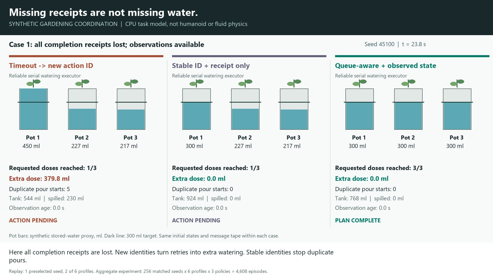

# Humanoid Gardening Queues

Historical task-level study, retained from commit 871019c. The statements below
describe that earlier CPU-only implementation. The new articulated GPU experiment
is separate; see the current [front page](README.md).

A separate, simulation-only project for a humanoid performing useful gardening
tasks with queue-aware task coordination.

**Now implemented: a reproducible watering-task comparison with 4,608 matched
simulation episodes.** This is a CPU task/communication model with a reliable
serial watering executor. It is **not yet a mass-bearing humanoid, soil, fluid,
GPU or hardware simulation**. No laundry results are relabeled as gardening.

[](https://github.com/rbajaj5/humanoid-gardening-queues/releases/download/watering-coordination-v1/watering_queue_comparison.mp4)

**[Watch the narrated, captioned comparison (42 seconds, 1080p)](https://github.com/rbajaj5/humanoid-gardening-queues/releases/download/watering-coordination-v1/watering_queue_comparison.mp4)**

The schematic movie shows a missing-receipt case and a permanent observation
outage. Its measurements are read from retained traces, not invented animation.

## The Measured Result

Dose-safe completion: all three requested doses delivered, with no pot receiving
more than 1 ml excess, evaluated at 50 s. Each cell below is successes / 256
matched seeds. This is a synthetic dose constraint, not proof of plant health.

| Communication condition | Timeout: new ID | Stable ID, receipt only | Queue-aware, observed state |
| --- | ---: | ---: | ---: |
| Timely feedback | 256/256 | 256/256 | 256/256 |
| Late completion receipts | 0/256 | 256/256 | 256/256 |
| All completion receipts lost | 0/256 | 0/256 | 256/256 |
| Temporary observation outage | 256/256 | 256/256 | 256/256 |
| Permanent observation outage | 256/256 | 256/256 | 0/256 |
| Combined delays/loss/outage | 0/256 | 256/256 | 256/256 |

With late receipts, timeout-based new identities caused **295.80 ml mean excess
delivery (SD 46.29)**; both stable-ID arms had zero excess. In the temporary
observation outage, the queue-aware arm took **15.39 s** on average to deliver
all doses, versus **8.20 s** for the receipt-only arms. With a permanent outage,
it delivered the first dose but held indefinitely within the 50 s horizon,
leaving two plants unfinished. Those failures are retained, not counted as success.

The point is not that more monitoring always wins. **Stable identity prevents
duplicate work; fresh physical evidence can restore progress without receipts;
requiring that evidence also creates an availability cost.** The receipt-only
ablation separates these mechanisms. Its successful handling of permanent sensor
loss suggests a possible hybrid based on trustworthy completion receipts, which
has not been tested here.

Zero excess in the stable-ID arms follows structurally from a fixed one-dose plan,
receiver deduplication and the reliable executor. It is not an empirical discovery
of a new optimal controller or evidence that this protocol handles arbitrary faults.

Full means, SDs, counts and limitations: [RESULTS.md](RESULTS.md).

## What the Experiment Does

The current model abstracts the body controller as a reliable serial executor.
Three pots have synthetic water-content states and fixed requested doses:

1. Associate each pot with a persistent identity and timestamped delivery observations.
2. Select a plant and issue an identified, bounded dose command.
3. Spend a synthetic travel time, then transfer water at a bounded flow rate.
4. Verify modeled delivered water before advancing the plan.
5. Re-observe the plant before authorizing another dose.

A missing completion receipt must not be interpreted as "no water was delivered."
Retransmission should preserve command identity; an uncertain in-progress dose
should block a conflicting second watering action. Expired sensor readings
should cause a new observation or an explicit hold, not an invented moisture value.

## Controls and Evidence

All three policies share an idempotent receiver, tank capacity, serial executor
and exogenous communication tape. The timeout baseline creates a new ID every
4 s without a completion receipt. The middle arm retries the same ID but still
waits for a completion receipt. The queue-aware arm retries the same ID and
advances only on a fresh observed delivered dose; its freshness limit is 0.5 s.
It holds new work and retransmissions when observations are stale.

Here receipts are generated **after actual modeled dose delivery**, not just
network reception. Receiver deduplication is in memory; restarts, multiple owners,
malicious receipts, incorrect plant identities and measurement bias are outside
the model. Old queued pours are never silently canceled when a planner advances.

Seeds 45100-45355 vary initial water deficits, travel duration, flow and message
tapes. Each seed/profile has an identical input hash across all three policies.
No outcome-driven parameter search was performed. The configuration was written
before the aggregate run, but this is exploratory work, not preregistration.

- [Configuration](config.json), [source](simulate.py), [tests](test_simulate.py).
- [All 4,608 episode outcomes](output/episodes.csv), [aggregate results](output/summary.json).
- [Validation and source hashes](output/validation.json), [media validation](output/media_validation.json).
- Full replay coverage: **18 episodes**, seed 45100 across all six profiles and
  three policies. The movie displays six of those traces in two cases, with a
  [frame-to-trace index](output/movie_frames.json). All episode inputs regenerate
  deterministically; full trajectories of the other 4,590 runs are not retained.

Water is conserved between tank, pot storage and overflow. Overflow is a capacity
accounting term, not a simulated splash. There is no evaporation, root biology,
fertilizer, vision or articulated tool manipulation. A fixed 300 ml target is a
synthetic setpoint, **not watering advice**. GPU computation would not make this
small task-state model more physically realistic.

## Reproduce

Python 3.11 standard library suffices for simulation and analysis:

```powershell
python simulate.py
python -m unittest -v
python analyze.py
```

For the schematic MP4, install Pillow and put FFmpeg on PATH. The current render
script uses Windows Segoe UI fonts; narration uses local Windows System.Speech.

```powershell
python -m pip install -r requirements-media.txt
python render.py
.\narrate.ps1 -Python python
python validate_media.py
```

Next: integrate an articulated humanoid and real tool/contact states, then check
whether these task-level results survive that physical model. Physics or learning
results must be measured independently, not inferred from this protocol demo.

## Related but Independent

- [Humanoid Laundry Queues](https://github.com/rbajaj5/humanoid-laundry-queues):
  predecessor for articulated-body modeling and task receipt/completion separation.
- [Assured Autonomy Lab](https://github.com/rbajaj5/delay-aware-runtime-assurance-lab):
  queue-aware assurance research; its numerical results are not gardening results.
- [Assured Autonomy RAG](https://github.com/rbajaj5/assured-autonomy-rag):
  literature retrieval and source provenance, not a robot controller.

This is not a subdirectory or branch of those repositories. No private class
corpus, credentials, external model weights or results have been copied here.

See [CHECKPOINT.md](CHECKPOINT.md) for the current implementation boundary.

## License

MIT for original project material. Any future robot models, meshes, datasets and
learned weights must retain their own licenses and pinned provenance.
