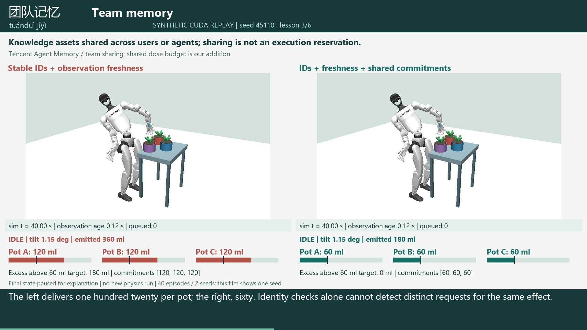

# Chinese Engineering Terms, Explained Through the GPU Garden

[](https://github.com/rbajaj5/humanoid-gardening-queues/releases/download/engineering-memory-narrated-2026-10-27/engineering_memory_narrated.mp4)

**[Watch the 3:44 narrated, captioned lesson](https://github.com/rbajaj5/humanoid-gardening-queues/releases/download/engineering-memory-narrated-2026-10-27/engineering_memory_narrated.mp4)**

**Main render + video encode: 4 min 44.57 s (284.57 s)** for 5,599 frames at
1920x1080 / 25 fps. One measured run, from FFmpeg's final elapsed-time record;
not inferred from file timestamps. This includes OpenGL/Pillow frame production
and CPU libx264 encoding, but excludes initial Python/model setup, audio assembly,
online speech generation, final audio/subtitle muxing, validation, upload and the
earlier CUDA physics simulations. Hardware: Intel Core Ultra 9 275HX, 32 GB RAM,
RTX 5070 Ti Laptop GPU with 12 GB VRAM. See the [timing record](output/render_timing.json)
and [retained encoder log](output/render_progress.txt). OpenGL rendering used
Intel Graphics on this run; the earlier physics used NVIDIA CUDA. This is not
a GPU rendering benchmark.

This narrated revision repairs the original silent reel's teaching gap: labels
alone did not explain the terminology. Each chapter now includes Mandarin term
pronunciation, pinyin, an English definition, a measured physical replay, and
an explanation of its outcome. English narration uses Andrew Neural and Mandarin
pronunciation uses Xiaoxiao Neural through `edge-tts` 7.3.1. These are synthetic
voices. Public script text is sent to Microsoft's online speech service; no
simulation records, credentials or private material are sent. No voice cloning.

Narration is generated at -5% rate. The video timing follows the measured speech
duration, with pauses, rather than speeding speech up to fit the original reel.
Burned-in captions and a separate [SRT](output/captions.srt) support muted playback.

## What Each Term Means

| Term | Meaning in this lesson | Physical coordination example |
|---|---|---|
| 工作记忆 / gōngzuò jìyì | Our engineering use: active task state. Related to, but not an exact synonym for, a model's context window or a vendor's short-term-memory category. | Current observations plus pending actions; nominal control. |
| 会话状态 / huìhuà zhuàngtài | Session context saved and restored during a task. | Restoring a plan must preserve its logical action identities. |
| 团队记忆 / tuánduì jìyì | Knowledge assets shared among agents or users. | Shared knowledge does not reserve authority to pour; queued commitments consume a shared task budget. |
| 记忆片段 / jìyì piànduàn | Information extracted and recalled later. | An old dry-pot snapshot is a physical analogy, not an implementation of vendor memory retrieval. |
| 观测时效 / guāncè shíxiào | Our label for observation freshness, not a cited vendor memory category. | A 0.5 s freshness gate prevents new skills during an observation outage, at an availability cost. |
| 长期记忆 / chángqī jìyì | Information retained across sessions. | Distinct from current state and permission to act; not implemented or benchmarked by this suite. |

Sources checked October 27, 2026:

- [Alibaba AgentRun: memory storage](https://help.aliyun.com/zh/agentrun/memory-storage-overview)
  distinguishes persistent memory, conversation history and session state.
- [Tencent Agent Memory](https://cloud.tencent.cn/document/product/1813/132100)
  describes short-term task context, persistent memory and shared team assets.
- [Alibaba Bailian: long-term memory](https://help.aliyun.com/zh/model-studio/long-term-memory)
  describes memory fragments and structured memory variables.

The operational execution rules are ours. These are not vendor safety claims,
product tests, psychological findings or an LLM-context-capacity experiment.

## Recorded Evidence, Not a New Experiment

The same 40 GPU episodes, two seeds and all original measured outcomes are
preserved. Only seed 45110 is shown. Initial states pause for definitions;
the demonstration phase traverses each retained 40-second episode faster than
real time; terminal states pause for explanation. There is no pose interpolation.
The concluding long-term-memory explanation reuses the nominal terminal state,
clearly labeled on screen. `output/movie_frames.json` records every source state
and the exact unique-sample coverage. Narration does not convert the simulation
into a new experiment, an LLM controller or a hardware demonstration.

The study still includes the unfavorable observation-outage result: guarded
delivery is 60/0/0 ml and the hold lasts 34.28 s. The target is 60 ml per pot;
extra dose is not automatically pot overflow or biological harm.

GPU physics was recorded earlier. The lesson renderer uses OpenGL; task logic,
frame composition and video encoding are not new CUDA simulations. The previous
silent reel and the earlier narrated missing-receipt movie remain separate.

## Reproduce

Use the repository's existing physical-garden environment for rendering and
validation. Install `edge-tts==7.3.1` in a separate Python environment for speech
so GPU package versions do not change. From the repository root:

```powershell
# Speech environment; sends only the public script text to online TTS.
python -m memory_study.lesson.speech
# Existing physical-garden environment:
python -m memory_study.lesson.render --preview
python -m memory_study.lesson.render
python -m memory_study.lesson.timing
python -m memory_study.lesson.verify
python -m memory_study.analyze
python -m unittest memory_study.test_protocol physical_garden.test_physics test_simulate -v
```

`script.json` contains the exact lesson. `output/timeline.json` records voices,
durations and audio hashes. The online speech service may change its outputs;
fresh synthesis creates a fresh timeline, so reproduction is not guaranteed to
be bit-for-bit. The release video and its hash identify this delivered version.
`build/` stores disposable audio and render intermediates and is not committed.
The media audit checks all decoded frames, source-state links, cue boundaries,
non-silent encoded narration and twelve encoded image samples. It is not an
automatic speech-recognition or Mandarin pronunciation evaluation.
